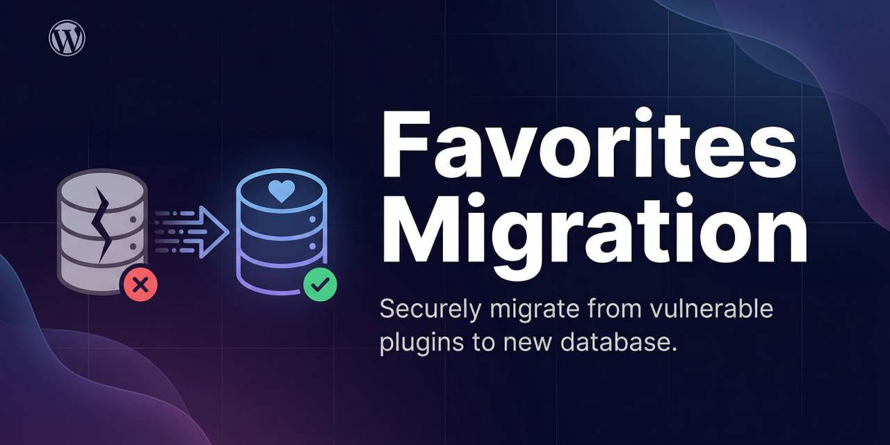

# Simple Favorites to My Favorites Migrator

A comprehensive WordPress plugin to migrate user favorites from Simple Favorites to My Favorites plugin with complete data integrity and shortcode replacement.

> **Archived.** This repository is read-only and kept as a reference. You can still fork it and adapt it to your own migration.

---

## ✨ Features

- 🔍 **Smart Analysis**: Analyze existing favorites data before migration
- 🚀 **One-Click Migration**: Seamlessly transfer all user favorites
- ✅ **Automatic Verification**: Compare data integrity after migration
- 🔄 **Shortcode Replacement**: Automatically replace shortcodes in posts, page builders, and widgets
- 🧹 **Safe Cleanup**: Remove old data only after successful verification
- 📊 **Progress Tracking**: Real-time feedback during migration process
- 🛡️ **Backup Friendly**: Works with your existing backup strategy

---

## 📋 Requirements

- WordPress 5.0 or higher
- PHP 7.2 or higher
- **Simple Favorites** plugin By Kyle Phillips (with existing data to migrate)
- **My Favorites** plugin By Takashi Matsuyama (must be installed and activated)

---

## 🚀 Installation

### Method 1: Manual Installation

1. Download the plugin from [GitHub](https://github.com/agenciaRSE/sf-to-mf-migrator)
2. Extract the ZIP file
3. Upload the `sf-to-mf-migrator` folder to `/wp-content/plugins/`
4. Activate through WordPress admin panel
5. Click "Start Migration" button in plugins list or navigate to "Favorites Migration" in admin menu

### Method 2: Direct Clone

cd wp-content/plugins/
git clone https://github.com/agenciarse/sf-to-mf-migrator.git

Then activate from WordPress admin.

---

## 📖 Usage Guide

### Step 1: 🔍 Analyze

Before starting migration, click Analyze Data to:
- Check how many users have favorites
- Count total favorites in the system
- Verify both plugins are installed
- Ensure database compatibility

What to check:
- ✅ Number of users with favorites
- ✅ Total favorites count
- ✅ My Favorites plugin is active

---

### Step 2: 🚀 Migrate

Transfer all favorites from Simple Favorites to My Favorites format.

What happens:
- Reads all Simple Favorites data
- Converts to My Favorites format
- Creates user meta entries
- Preserves all relationships
- Shows progress in real-time

This process:
- ✅ Does NOT delete original data
- ✅ Can be run multiple times safely
- ✅ Takes a few seconds for most sites

---

### Step 3: ✅ Verify

Compare both systems to ensure 100% data integrity.

Verification checks:
- User counts match
- Favorite counts match
- Individual user data matches
- Displays any discrepancies

Important: Do not proceed to cleanup until verification shows 100% match!

---

### Step 4: 🔄 Replace Shortcodes

Automatically update shortcodes throughout your entire site:

Replacements made:
- [favorite_button] becomes [ccc_my_favorite_select_button]
- [user_favorites] becomes [ccc_my_favorite_list_results]

Searches in:
- ✅ Post content
- ✅ Page content
- ✅ Custom post types
- ✅ Page builder content (Elementor, etc.)
- ✅ Widget content
- ✅ ACF fields

Safe features:
- Creates backup before replacing
- Shows preview of changes
- Can be reverted if needed

---

### Step 5: 🧹 Cleanup

Remove old Simple Favorites data after successful verification.

⚠️ WARNING: This step is irreversible!

Only run cleanup when:
- ✅ Verification shows 100% match
- ✅ You have tested favorites on frontend
- ✅ Shortcodes are working correctly
- ✅ You have a database backup

What gets removed:
- Old user meta from Simple Favorites
- Simple Favorites settings
- Legacy data structures

What stays:
- All posts and pages
- Your new My Favorites data
- Site settings and other plugins

---

## 🎯 Complete Migration Checklist

Before starting:
- [ ] Backup your database
- [ ] Install My Favorites plugin
- [ ] Activate both plugins
- [ ] Test on staging site first (recommended)

During migration:
- [ ] Run Step 1: Analyze
- [ ] Run Step 2: Migrate
- [ ] Run Step 3: Verify (wait for 100% match)
- [ ] Test favorites on frontend
- [ ] Run Step 4: Replace Shortcodes
- [ ] Test shortcodes on frontend
- [ ] Run Step 5: Cleanup (only after everything works)

After migration:
- [ ] Deactivate Simple Favorites plugin
- [ ] Delete Simple Favorites plugin
- [ ] Test user experience thoroughly
- [ ] Deactivate this migrator plugin
- [ ] Keep this plugin for future reference

---

## 🆘 Troubleshooting

### Verification does not show 100% match

Solution:
1. Check if all users are logged in correctly
2. Clear any caching plugins
3. Run migration again
4. Contact support if issue persists

### Shortcodes not working after replacement

Solution:
1. Clear page cache
2. Regenerate page builder cache
3. Check My Favorites plugin settings
4. Verify shortcode syntax in posts

### Migration seems stuck

Solution:
1. Increase PHP max_execution_time
2. Increase PHP memory_limit
3. Disable other plugins temporarily
4. Check server error logs

### Data mismatch after migration

Solution:
1. Do NOT run cleanup yet
2. Check WordPress error logs
3. Verify database permissions
4. Run migration process again
5. Contact support with error details

---

## Technical Details

### Database Structure

Simple Favorites stores data as:
- User meta key: simplefavorites
- Format: Serialized array of post IDs

My Favorites stores data as:
- User meta key: ccc_my_favorite_post
- Format: Serialized array with post IDs as keys

### Migration Process

1. Query all users with simplefavorites meta
2. For each user:
   - Get Simple Favorites array
   - Convert to My Favorites format
   - Add/update ccc_my_favorite_post meta
3. Verify counts and data integrity
4. Optional: Clean up old data

### Shortcode Mapping

| Simple Favorites | My Favorites |
|-----------------|--------------|
| [favorite_button] | [ccc_my_favorite_select_button] |
| [user_favorites] | [ccc_my_favorite_list_results] |

---

## Frequently Asked Questions

### Will this delete my original data?

No, not until you explicitly run the Cleanup step. Migration creates new data alongside the old data.

### Can I run migration multiple times?

Yes, the migration is idempotent. Running it multiple times will update the data without creating duplicates.

### What happens if I deactivate during migration?

The process will stop, but no data will be lost. You can reactivate and continue.

### Do I need to keep this plugin installed?

After successful migration and cleanup, you can safely deactivate and delete this plugin.

### Will users lose their favorites?

No, if you follow the process correctly, all favorites will be preserved perfectly.

### Does this work with multisite?

Currently, this plugin is designed for single-site installations. Multisite support is planned for future versions.

---

## 💡 Support

Need help? We are here for you!

- 📖 Documentation: https://github.com/agenciarse/sf-to-mf-migrator
- 🐛 Report Issues: https://github.com/agenciarse/sf-to-mf-migrator/issues
- 📧 Email: dev@agenciarse.com
- 🌐 Website: agenciarse.com

---

## 📄 License

This plugin is licensed under GPL v2 or later.

Copyright (C) 2025 AGENCIA RSE

This program is free software; you can redistribute it and/or modify it under the terms of the GNU General Public License as published by the Free Software Foundation; either version 2 of the License, or (at your option) any later version.

Full license: LICENSE

---

## 👥 Credits
Developed with ❤️ by AGENCIA RSE

Author: AGENCIA RSE
Contact: dev@agenciarse.com
Website: https://agenciarse.com

---

## 🤝 Contributing

Contributions, issues, and feature requests are welcome!

1. Fork the Project
2. Create your Feature Branch (git checkout -b feature/AmazingFeature)
3. Commit your Changes (git commit -m 'Add some AmazingFeature')
4. Push to the Branch (git push origin feature/AmazingFeature)
5. Open a Pull Request

---

## Show Your Support

If this plugin helped you, please:
- ⭐ Star this repository
- 🐦 Share on social media
- 📝 Write a review
- ☕ Buy us a coffee at https://agenciarse.com/stripe

---

## 📊 Stats

---

## ⚠️ Disclaimer

Always backup your database before running any migration tool.

While this plugin has been thoroughly tested, we are not responsible for any data loss. Use at your own risk and always test on a staging environment first.

---

## Changelog

### Version 1.0.0 - 2025
- ✨ Initial release
- 🔍 Analysis functionality
- 🚀 Migration system
- ✅ Verification tools
- 🔄 Shortcode replacement
- 🧹 Cleanup utilities

---

## 🗺️ Roadmap

- [ ] Add bulk operations for large sites
- [ ] Support for custom post types
- [ ] Export/import migration reports
- [ ] Scheduled migrations
- [ ] WP-CLI support
- [ ] Multisite compatibility

---

## 📞 Contact
AGENCIA RSE

🌐 Website: https://agenciarse.com
📧 Email: dev@agenciarse.com
🐙 GitHub: @agenciaRSE

---

Made with ❤️ by AGENCIA RSE
Website • Email • GitHub
